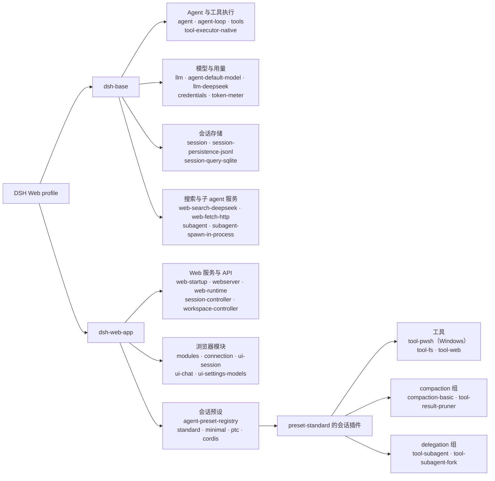

# DSH Web profile 简化插件树

上游 commit 为 `9c2670d3bce5275e0d1610272958121af87787bb`。本图基于当前 Windows 用户的 [Web profile 配置导出](DSH-web-profile.yml)，其中 `dsh-base` 提供 99 条顶层配置，`dsh-web-app` 提供 103 条。合计 202 条，包含 24 条显式禁用和 10 条按条件禁用的配置。

图中按 bundle 来源和用途展示代表性的插件 ID。`standard` 子分支对应导出中的 `preset-standard.config.plugins`。YAML 中保留的 `!!js` 条件在 Web 启动或会话加载时求值。

Web 在顶层禁用了 `tool-pwsh`、`tool-fs`、`tool-web`、`compaction-basic` 和 `tool-subagent` 等通用条目。选择 `standard` 预设时，对应插件由该预设在会话内提供。

配置由当前检出的 CLI 使用 `--profile web --dump-config` 导出。该命令合成已有的 bundle 和 profile 补丁，保留动态表达式。
